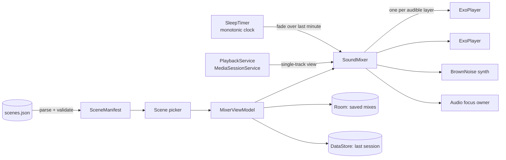

<div align="center">

# 🕯️ Lamplight

**Pick a place, not a sound. Then let it play all night.**

An ambient sound app for Android built around cozy scenes: a cabin with a fire, a rainy window seat, a quiet library, a tent in the woods. Layer sounds on top, turn the screen off and drift away on a sleep timer that fades instead of cutting.


</div>

---

## Why it is interesting

| | |
|---|---|
| 🎚️ **A real mixer, not a playlist** | One ExoPlayer per *audible* layer, each with its own volume, all under a single audio focus owner. |
| 📻 **One track to the OS** | A `MediaSessionService` presents the whole mix as a single track, so the lock screen, Bluetooth and headset buttons control every layer at once. |
| 🌊 **Brown noise with no seam** | Synthesized in code with an equal-power crossfade at the loop point. No bundled file, no click. |
| ⏱️ **A timer you cannot break** | Runs on a monotonic clock. Changing the wall clock or time zone at 2 a.m. cannot shorten it. |
| 🧩 **Scenes are data** | Every scene, sound and layer lives in `scenes.json`, validated at startup. A new scene is zero lines of Kotlin. |

## How it works



## Engineering notes

**Players exist only while they are heard.** Disabling a layer releases its player, and a paused mix holds no decoder at all. The mixer owns audio focus for the whole mix, so several players never fight over it: a phone call pauses everything and resumes afterwards, while another app taking focus for good leaves the mix paused.

**Seamless generated noise.** The brown noise layer is generated, not shipped. Its loop point is an equal-power crossfade, so the last sample flows into the first with no audible seam ([`audio/BrownNoise.kt`](app/src/main/java/br/com/rodsil/lamplight/audio/BrownNoise.kt)).

**A gentle exit.** The sleep timer fades the mix out over its final minute instead of stopping it, because a sudden silence wakes people up.

**Two taps to calm.** A scene's base ambience starts the moment you open it, and the last session is restored from DataStore, so the picker resumes where you left off.

**Measured, not guessed.** Firebase Analytics records a `playback_stopped_unexpectedly` event, which shows how aggressively each device maker kills background audio.

## Features

- Scene picker with layered ambience and per-layer volume
- Background playback with notification and lock-screen controls
- Sleep timer with a one-minute fade-out
- Saved mixes (Room) and one-tap resume (DataStore)
- Pro purchase through Google Play Billing 9 for unlimited saved mixes

> **Status:** in development. The audio engine, background playback, sleep timer, saved mixes and Pro purchase work. The bundled sounds are generated placeholders and the scene illustrations are not in yet.

## Tech stack

| Layer | Choice |
|---|---|
| Language | Kotlin 2.3 |
| UI | Jetpack Compose, Material 3, Navigation 3 |
| Audio | Media3 ExoPlayer and MediaSession |
| DI | Hilt |
| Persistence | Room (exported schemas), DataStore |
| Serialization | kotlinx.serialization |
| Monetization | Google Play Billing 9 |
| Analytics | Firebase Analytics (optional) |
| Platform | Min SDK 26, target SDK 36 |

## Project structure

```
app/src/main/java/br/com/rodsil/lamplight/
├── audio/       Mixer, per-layer players, audio focus, brown noise synthesis
├── playback/    MediaSessionService and the single-track view of the mix
├── scene/       Scene manifest parsing and validation
├── mix/         Saved mixes (Room)
├── session/     Last session persistence (DataStore)
├── timer/       Sleep timer with fade-out
├── pro/         Play Billing purchase flow
├── analytics/   Event definitions and playback session tracking
└── ui/          Scene picker, mixer, Pro and help screens
tools/           Placeholder sound generator
```

## Tests

Unit tests cover the logic that is easy to get wrong:

| Area | What is verified |
|---|---|
| `MixerStateTest` | Layer state transitions and volumes |
| `BrownNoiseTest` | Seamless loop point |
| `SleepTimerTest` | Countdown and fade curve |
| `SceneManifestTest` | Manifest validation rejects broken scenes |
| `MixRepositoryTest` | Saved mix limits for free and Pro |
| `LastSessionTest` | Session restore |
| `ProPurchasesTest` | Purchase state |
| `PlaybackSessionTrackerTest` | Unexpected stop detection |

## Running

```bash
./gradlew assembleDebug
./gradlew testDebugUnitTest
```

Analytics needs a Firebase `google-services.json` in `app/`. Without it the app builds and runs with analytics turned off.
